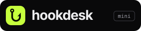

[](https://www.npmjs.com/package/hookdesk)
[](https://nodejs.org)
[](./LICENSE)

Local-only webhook inspector. Point any webhook or HTTP client at `http://127.0.0.1:4317/hook/...` and watch requests land in a live browser dashboard, where you can inspect headers and bodies, copy them as cURL, and replay them. No account, no cloud, no database, and no npm dependencies. The npm package and the command are both **hookdesk**.

## What It Does

- captures any HTTP method on any path under `/hook/`
- live activity timeline: one spike per request, colored by method, taller for bigger bodies
- live stats: requests in memory, requests in the last minute, time since the last request, total body size
- request table, newest first, with method, path, size, and age
- request detail with tabs: syntax-highlighted JSON body with line numbers, a headers table, and a ready cURL command
- replays a captured request to the local inbox, never to its original sender
- redacts credential headers (`authorization`, `cookie`, `x-api-key`, and more) in the dashboard and API
- keyboard navigation: `j` / `k` to move, `r` to replay, `c` to copy as cURL
- dark, light, or auto theme, remembered per browser
- every limit, path, header list, and UI setting is configurable through a JSON config file
- binds to `127.0.0.1` only, with `Host` and `Origin` checks

## Requirements

- Node.js 20+
- macOS, Linux, or Windows

## Install

```bash
npm install -g hookdesk
```

Or run it once without installing:

```bash
npx hookdesk
```

### From source

```bash
git clone https://github.com/psandis/hookdesk.git
cd hookdesk
npm link
hookdesk
```

There is nothing to install or build: hookdesk has no dependencies. Without linking, use `npm start` in place of `hookdesk`.

## Quick Start

Start the dashboard:

```bash
hookdesk
```

```
  HookDesk Mini is running
  Dashboard: http://127.0.0.1:4317
  Webhook:   http://127.0.0.1:4317/hook
  Example:   curl -X POST http://127.0.0.1:4317/hook/demo -H 'Content-Type: application/json' -d '{"event":"hello"}'
```

Open the dashboard URL in a browser, then send a test request from another terminal.

macOS / Linux:

```bash
curl -X POST http://127.0.0.1:4317/hook/order.created \
  -H 'Content-Type: application/json' \
  -d '{"event":"order.created","orderId":123,"amount":49.90}'
```

Windows (PowerShell):

```powershell
Invoke-RestMethod -Method Post -Uri http://127.0.0.1:4317/hook/order.created `
  -ContentType 'application/json' `
  -Body '{"event":"order.created","orderId":123,"amount":49.90}'
```

The request appears in the dashboard within the poll interval (1.5 seconds by default). Stop the server with `Ctrl+C`.

## Dashboard

### Header

- **Logo**: brand mark on the left
- **host / buffer / storage**: bind address, how many requests are kept, and where (memory)
- **Live**: whether the dashboard can reach the local server; turns to **Offline** when it cannot
- **Theme**: `Auto` follows the operating system, `Light` and `Dark` force a theme. The choice is remembered in the browser.

### Stats

| Tile | Shows |
|---|---|
| Captured | Requests held in memory |
| Last 60 s | Requests received in the past minute |
| Last hit | Time since the newest request |
| In memory | Total size of all request bodies. Hover for the exact byte count. |

### Activity timeline

The last 5 minutes (`ui.timelineWindowMs`) of traffic. Each spike is one request: its color is the HTTP method (see the legend), its height grows with the body size on a log scale. Hover a spike to preview the request, click it to open it. New requests pulse when they arrive.

### Send a test

The command bar shows a ready `curl` command for your endpoint.

| Button | Action |
|---|---|
| Copy endpoint | Copies the base URL, for pasting into a webhook provider or your app |
| Copy curl | Copies the test command |
| Refresh | Reloads the request list immediately |
| Clear | Deletes all captured requests, after a confirmation |

### Requests

A table of captured requests, newest first.

| Column | Description |
|---|---|
| Method | HTTP method, colored as in the timeline legend |
| Path | Path and query string. Replayed requests are marked `replay`. |
| Size | Body size. Hover for the exact byte count. |
| Age | Time since the request arrived, updated every second |

### Request detail

Clicking a row opens the request with its path, method, received date and time, size, and short ID.

| Tab | Content |
|---|---|
| Body | The body as received. JSON is pretty-printed and syntax-highlighted with line numbers. |
| Headers | All headers. Sensitive values show as `[REDACTED]`. |
| cURL | A command that re-sends the request, without redacted headers |

**Replay locally** re-sends the request to this hookdesk inbox, never to the original sender. Credential headers and hop-by-hop headers are stripped; the body is re-sent unchanged. `CONNECT`, `TRACE`, and `TRACK` requests cannot be replayed.

### Keyboard

| Key | Action |
|---|---|
| `j` or `Down` | Next request |
| `k` or `Up` | Previous request |
| `r` | Replay the selected request |
| `c` | Copy the selected request as cURL |

## Configuration

All defaults live in [`config/default.json`](config/default.json). To change them, create a JSON file with only the keys you want to override and pass it with `--config`:

```json
{
  "capture": { "maxEvents": 50, "pathPrefix": "/inbox" },
  "redaction": { "sensitiveHeaders": ["authorization", "cookie", "x-signature"] },
  "ui": { "defaultTheme": "light" }
}
```

```bash
hookdesk --config=./hookdesk.config.json
```

Values are merged in this order, later ones win:

1. built-in defaults (`config/default.json`)
2. the file passed with `--config=<path>`
3. the `PORT` environment variable
4. the `--port=<number>` flag

Changing the port:

```bash
# macOS / Linux
hookdesk --port=4343
PORT=4343 hookdesk
```

```powershell
# Windows (PowerShell)
hookdesk --port=4343
$env:PORT=4343; hookdesk
```

### Settings

| Key | Type | Default | Description |
|---|---|---|---|
| `server.host` | string | `127.0.0.1` | Bind address. Must be loopback: `127.0.0.1`, `localhost`, or `::1` |
| `server.port` | integer | `4317` | Port. `0` picks a free port |
| `server.allowedHostnames` | string[] | `["127.0.0.1", "localhost"]` | Accepted `Host` and `Origin` hostnames. Loopback names only |
| `capture.pathPrefix` | string | `/hook` | Path under which requests are captured |
| `capture.maxBodyBytes` | integer | `1048576` | Body size limit (1 MiB). Larger bodies get HTTP 413 |
| `capture.maxEvents` | integer | `200` | Number of requests kept in memory |
| `replay.timeoutMs` | integer | `5000` | Replay request timeout |
| `replay.blockedMethods` | string[] | `["CONNECT", "TRACE", "TRACK"]` | Methods that cannot be replayed |
| `replay.excludedHeaders` | string[] | hop-by-hop and browser headers | Headers dropped on replay. Sensitive headers are always dropped too |
| `redaction.sensitiveHeaders` | string[] | `authorization`, `cookie`, `x-api-key`, ... | Headers shown as the placeholder in the dashboard and API |
| `redaction.placeholder` | string | `[REDACTED]` | Replacement text for redacted values |
| `ui.pollIntervalMs` | integer | `1500` | Dashboard refresh interval |
| `ui.timelineWindowMs` | integer | `300000` | Time span of the activity timeline (5 minutes) |
| `ui.defaultTheme` | string | `auto` | `auto`, `light`, or `dark`. Each viewer can still switch in the header |
| `ui.curlExcludedHeaders` | string[] | `host`, `content-length`, ... | Headers left out of "Copy as cURL" |

### Validation

The configuration is validated at startup. Unknown keys (usually typos) and invalid values stop the server with exit code 1:

```
$ hookdesk --config=./hookdesk.config.json
Unknown config key "capture.maxEvent"

$ hookdesk --port=abc
Invalid configuration:
  - server.port must be an integer 0..65535 (0 picks a free port)
```

## Storage

hookdesk writes nothing to disk. Captured requests are held only in memory (the last `capture.maxEvents`, default 200) and are erased when the server stops or restarts. The only file it reads besides its own is the optional `--config` file. The theme choice is kept in the browser's `localStorage`.

## API

hookdesk exposes a local REST API on the same port as the dashboard.

| Method | Path | Description |
|---|---|---|
| any | `/hook`, `/hook/*` | Capture a request |
| `GET` | `/api/events` | List captured requests (summaries, no headers or body) |
| `GET` | `/api/events/:id` | One request with redacted headers and the body |
| `POST` | `/api/events/:id/replay` | Replay a request to the local inbox |
| `DELETE` | `/api/events` | Clear all captured requests |
| `GET` | `/api/config` | Settings the dashboard uses |

All endpoints return JSON.

## Security

- Binds to loopback only. `Host` and `Origin` checks block DNS rebinding and cross-site requests from web pages.
- The dashboard is served with a strict Content Security Policy and no inline scripts or styles.
- Sensitive headers are redacted in the dashboard and API. **Bodies are not redacted**, so do not send production credentials or personal data to it.
- hookdesk is not a tunnel. To receive webhooks from an external provider, use a trusted tunnel separately.
- Bodies are stored as UTF-8 text; binary payloads are not supported yet.

## Testing

```bash
npm test
```

Current bar:

- 30 tests across config loading and the HTTP server, using the built-in Node.js test runner
- integration tests run a real HTTP server on port 0
- expected defaults are read from `config/default.json`, so changing a setting does not break tests; only the security requirements (loopback binding, `authorization` redaction, blocked replay methods) are fixed values
- the `hookdesk` command is tested by launching it through a symlink, the way `npm install -g` runs it

## Tech Stack

| Tool | Purpose |
|---|---|
| Node.js 20+ | Runtime |
| node:http | HTTP server, no framework |
| Vanilla JS / HTML / CSS | Dashboard, no frontend framework, no build step |
| Canvas 2D | Activity timeline |
| node:test | Testing |

## File Structure

```
hookdesk/
├── config/
│   └── default.json        default settings
├── src/
│   ├── server.js           HTTP server, API, and the hookdesk command
│   ├── config.js           config loading, merging, and validation
│   ├── ui.html             dashboard markup
│   ├── ui.css              dashboard styles and themes
│   ├── ui.js               dashboard logic and timeline
│   ├── logo.svg            logo and favicon
│   └── wordmark.svg        README wordmark
├── tests/
│   ├── config.test.js
│   └── server.test.js
├── package.json
├── LICENSE
└── README.md
```

## Next Steps

1. Configurable mocked responses (status, body, and delay per path)
2. Request filtering and search
3. Export and import of captured requests as JSON
4. Binary payload support

## Related

- [wiremonitor](https://github.com/psandis/wiremonitor): Network traffic web dashboard
- [portmind](https://github.com/psandis/portmind): Scan listening ports and remember what normally runs where
- [mydevkit](https://github.com/psandis/mydevkit): Everyday developer tools in one CLI
- [nscout](https://github.com/psandis/nscout): Scout a name across npm, GitHub, PyPI, and domain registries

## License

See [MIT](LICENSE)
